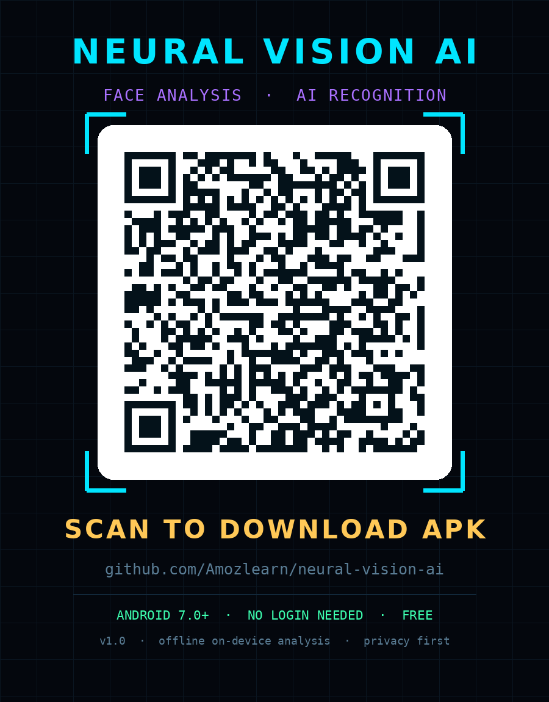

# NEURAL VISION AI ⚡🧠

**Face Analysis & Recognition — Cyberpunk Android + Web App**

## 📱 Download APK — no login needed

Scan the QR with your phone camera, or open this link directly:

**https://github.com/Amozlearn/neural-vision-ai/releases/latest/download/NeuralVisionAI.apk**

  

### Install
1. Enable **Unknown sources** in Android settings (Settings → Security)
2. Open the downloaded `NeuralVisionAI.apk`
3. Grant camera permission for live scan mode

> Requires Android 7.0+

## ✨ Features

| | |
|---|---|
| 🎯 | 12-metric facial scoring dashboard |
| 🔷 | 7 face shapes detection (Oval, Round, Square, Heart, Diamond, Oblong, Rectangle) |
| 📐 | Facial proportion analysis (estimated) |
| 💇 | Hairstyle / beard / eyebrow / glasses suggestions |
| 🪞 | Before / After pixel preview |
| 🔐 | Self-referential face recognition (consent-based, local-only) |
| 🛡️ | Cyber Privacy Center |
| 📄 | PDF report export |

## 🔒 Privacy

All analysis runs **100% on-device** — no uploads, no accounts, no tracking, no raw face images stored.

## 🔧 Build

Every push to this repo auto-builds the APK via **GitHub Actions** and publishes it to **Releases**.
The download link above always points to the latest build.
